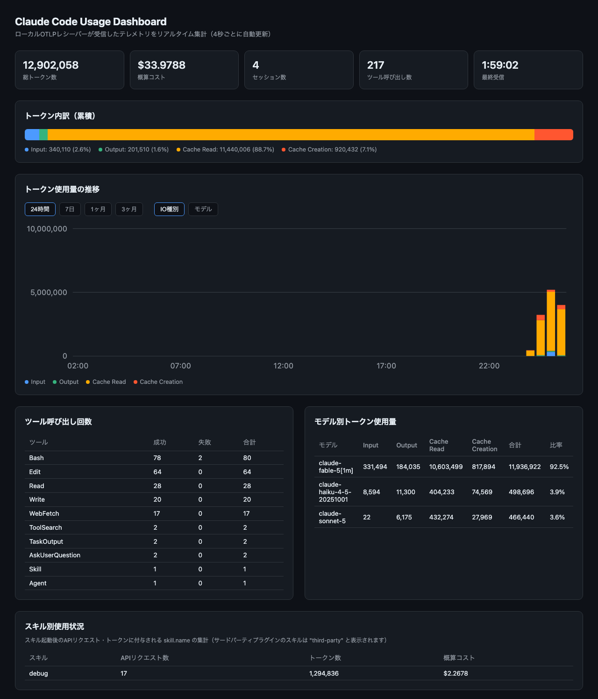

# otel-agent

Claude Code の公式 OpenTelemetry テレメトリをローカルで受信し、
localhost のダッシュボードでツール呼び出し回数・トークンIO比率・モデル比率・
スキル別使用状況を可視化するエージェントです。外部npm依存はゼロ
（Node.js組み込みの `node:http` / `node:sqlite` のみ）。

Claude Code の OTel エクスポートは API従量課金・サブスクリプション(Pro/Team/
Enterprise) いずれの認証方式でも動作するCLI自体の機能のため、契約形態を変えても
このパイプラインは影響を受けません。



## 使い方

### 1. 受信サーバー + ダッシュボードを起動

```bash
npm start
# -> http://localhost:4318 でダッシュボード + OTLP受信(/v1/metrics, /v1/logs)が起動
```

### 2. 別ターミナルで Claude Code をテレメトリ有効化して起動

```bash
export CLAUDE_CODE_ENABLE_TELEMETRY=1
export OTEL_METRICS_EXPORTER=otlp
export OTEL_LOGS_EXPORTER=otlp
export OTEL_EXPORTER_OTLP_PROTOCOL=http/json
export OTEL_EXPORTER_OTLP_ENDPOINT=http://localhost:4318
export OTEL_METRIC_EXPORT_INTERVAL=5000   # 動作確認用に短縮（デフォルト60秒）
export OTEL_LOGS_EXPORT_INTERVAL=5000

claude
```

### 3. ブラウザで確認

http://localhost:4318 を開く。4秒ごとに自動更新（8原則セルフチェックは1分ごと）。

### テスト

```bash
npm test
```

## 収集しているデータ

- `claude_code.token.usage` メトリクス（input/output/cacheRead/cacheCreation別、model別）
- `claude_code.cost.usage` メトリクス（概算コスト）
- `claude_code.session.count` メトリクス
- `tool_result` ログイベント（ツール別呼び出し回数・成功/失敗。スキル呼び出しも
  `Skill` ツールとして記録される）
- スキル別使用状況（`api_request` / `token.usage` / `cost.usage` に自動付与される
  `skill.name` 属性の集計。追加フラグ不要。サードパーティプラグインのスキル名は
  Claude Code 側で "third-party" に置換されて届く）
- モデル別トークン使用量（モデルごとに種別内訳と全体に占める比率%を表示）
- トークン使用量の時系列グラフ（24時間/7日/1ヶ月/3ヶ月で期間切替、
  積み上げの単位を IO種別 / モデルファミリーで切替）
- 受信ログイベントの直近15件は「直近イベント」テーブルに生表示

デフォルトではプロンプト本文やツール引数の詳細はAnthropic側で redact されます。
必要な場合は `OTEL_LOG_USER_PROMPTS=1` / `OTEL_LOG_TOOL_DETAILS=1` を追加してください
（機密情報を含む可能性があるため、本番でのSnowflake連携時は取り扱いに注意）。

## 8原則セルフチェック

[「AIエージェントのトークン消費を最小化する8つの原則」](https://speakerdeck.com/kinopeee/draft-ai-ejento-no-tokun-shouhi-o-saishouka-suru-8-tsu-no-gensoku)に沿って、
トークンの割に成果が残っていない原因をセッション単位で判定します。ダッシュボードの「8原則セルフチェック」と、
プラグインに同梱のスキル `/token-checkup`（Claude Code が結果を読んで次に試すことを説明する）から見られます。

- 判定はこのPCのDBだけで行い、プロンプト本文・ファイルパスは使いません（`OTEL_LOG_USER_PROMPTS` 等は不要）
- 主指標は「コミット/PR 1件あたりのコスト」と「成果が残らなかったコストの割合」
- 兆候は該当セッションのコスト合計が大きい順に並びます
- API: `GET /api/diagnosis?days=7&top=3`（`days` は 1 / 7 / 30 / 90）

セッションの成果は次の順で分類します: `shipped`（コミットかPRあり）/ `changed`（変更行のみ）/
`no_change`（編集を試みたが残らず）/ `explore`（編集なし。調査・質問なので失敗扱いしない）。

| 原則 | 兆候 | 使うデータ | 既定の閾値 |
|---|---|---|---|
| 1 入力を減らす | 最初の編集までの探索（Read/Grep/Glob等）が多い | `tool_result` の順序 | 15回 |
| 1 | 巨大なツール結果を読み込んでいる | `tool_result_size_bytes` | 40KB以上が2回 |
| 1 | 会話開始時の固定コンテキストが重い（MCP・CLAUDE.md） | 最初の `api_request` の入力合計 | 4万トークン |
| 2 コンテキストの寿命 | 1つの会話を長く引っ張っている | `api_request` の入力合計の最大 | 15万トークン |
| 2 | 上限まで使い切って自動圧縮されている | `query_source=compact`（直前が `/compact` なら除外） | 1回 |
| 3 往復を減らす | 同じツールを1件ずつ繰り返している | `tool_result` の連続 | 10回 |
| 3 | 短い追い発言での往復が多い | `user_prompt.prompt_length` | 20文字未満が3割 |
| 4 やり直しを早く止める | 同じツールの連続失敗 | `tool_result.success` | 3回 |
| 4 | ツール実行の却下が多い | `tool_decision.decision=reject` | 3回 |
| 5 出力を減らす | 部分編集でなく全書き換え | Write と Edit の `tool_input_size_bytes` | Write 20KB以上かつ Edit の2倍超 |
| 5 | 変更量に対して出力が多い | `output_tokens` / 変更行数 | 200トークン/行 |
| 6 キャッシュを壊さない | ヒット率が低い | `cache_read_tokens` の割合 | 70%未満 |
| 6 | 会話途中でキャッシュを作り直している | 2回目以降の `cache_creation_tokens` | 5万トークンが2回 |
| 7 モデルの使い分け | 小さな作業に最上位モデル・高 effort | `model` / `effort` 別コスト | 変更30行未満でコストの8割 |
| 8 計測してから最適化 | 使用量を確認した形跡がない | `user_prompt.command_name`（cost/usage/context/stats） | 期間内に0回 |

閾値は仮置きです。社内の分布を見て `src/diagnose.js` の `THRESHOLDS` を調整してください。
サブエージェント（`agent_id` あり）やタイトル生成などの補助リクエストは、探索回数や固定コンテキストの判定から除いています。

## データの保存先

デフォルトはプロジェクト直下の `otel-agent.db`（SQLite）。`OTEL_AGENT_DB_PATH` で変更可能。
プラグイン経由で起動した場合はプラグインデータディレクトリ配下に保存されます。

収集データ（メトリクス・ログ）は `OTEL_AGENT_DATA_RETENTION_DAYS`（デフォルト100日、
3ヶ月グラフが機能する日数）を超えた分が起動時と1時間ごとに自動削除されるため、
DBが無制限に肥大化することはありません（削除後の空き領域はSQLiteが再利用します）。

## ゲートウェイ転送（store-and-forward）

受信した生OTLPペイロードを `outbox` テーブルに永続化し、社内ゲートウェイへ定期送信します。
**VPN切断などで送信に失敗した分はローカルに残り、到達可能になった時点で自動再送**されます。

| 環境変数 | 意味 | デフォルト |
|---|---|---|
| `OTEL_AGENT_FORWARD_URL` | 転送先URL。**未設定なら転送無効**（ローカル収集のみ） | 無効 |
| `OTEL_AGENT_FORWARD_TOKEN` | `Authorization: Bearer` に付与するトークン | なし |
| `OTEL_AGENT_FORWARD_INTERVAL_MS` | 送信間隔 | 60000 |
| `OTEL_AGENT_RETENTION_DAYS` | 送信済みレコードの保持日数（超過分は削除） | 7 |

送信形式: `POST <URL>` に `{"records": [{"id", "received_at", "kind": "metrics"|"logs", "payload": <生OTLP JSON>}]}`。
2xx応答で送信済みとしてマークします。ゲートウェイ側はこれを受けてSnowflakeへ取り込む想定。

## プラグインとして配布（試作）

このリポジトリ自体がマーケットプレイス兼プラグインです（`.claude-plugin/`）。

```
/plugin marketplace add togishima/otel-agent
/plugin install otel-agent@otel-agent-marketplace
/reload-plugins                  # 現在のセッションで即有効化する場合
```

ローカルでの開発時はリポジトリ直下で `/plugin marketplace add .` でも追加できます。

インストール時に `gateway_url`（任意）を設定できます。空のままなら転送無効。

### インストール後の動作確認

1. 新しいセッションを開始（SessionStart hookでエージェントが起動）
2. http://localhost:4318 でダッシュボードが開けること
3. `~/.claude/settings.json` の `env` に `CLAUDE_CODE_ENABLE_TELEMETRY` 等が
   マージされていること（テレメトリ送信はさらに次のセッションから始まる）
4. ログ: `<プラグインデータディレクトリ>/logs/server.log`（起動失敗時は `server.err.log` と `setup.log`）

### アンインストール

```
/plugin uninstall otel-agent@otel-agent-marketplace
/plugin marketplace remove otel-agent-marketplace
```

`~/.claude/settings.json` にマージされたテレメトリenvと、プラグインデータディレクトリの
DB/ログは自動では消えないため、不要なら手動で削除してください。

SessionStart hook（`scripts/ensure-agent.sh`）が毎セッション冪等に以下を行います:

1. `~/.claude/settings.json` の `env` にテレメトリ設定をマージ
   （`CLAUDE_CODE_ENABLE_TELEMETRY=1`, `OTEL_*` 一式。**既存キーは上書きしない**。反映は次セッションから）
2. エージェント未起動なら起動（DB/ログはプラグインデータディレクトリ配下、
   `gateway_url` は `CLAUDE_PLUGIN_OPTION_GATEWAY_URL` 経由で転送設定に反映）

エージェントの実行方法は次の順で自動解決されます:

1. 取得済みの単一バイナリ（`<プラグインデータディレクトリ>/bin/otel-agent`）
2. PATH上の `node`（>= 22.5）
3. **nodeがないマシンでは GitHub Release から単一バイナリを自動ダウンロード**して実行
   （非開発者PC対応。ダウンロード先は `OTEL_AGENT_RELEASE_BASE` で変更可能）

## 単一バイナリのビルド

Node公式のSEA（Single Executable Application）でNode非依存の単一バイナリを生成できます。

```bash
npm run build:sea
# -> dist/otel-agent-<os>-<arch>（約120MB、ダッシュボードのHTML/CSS/JSも埋め込み済み）

# サーバー起動（node不要）
./dist/otel-agent-darwin-arm64

# ~/.claude/settings.json へのテレメトリenvマージのみ実行
./dist/otel-agent-darwin-arm64 merge-env
```

ビルドしたマシンと同じOS/CPU用のバイナリのみ生成されます（クロスビルド未対応）。
配布は GitHub Release にアセット名 `otel-agent-<os>-<arch>`（`uname -s | tr A-Z a-z`-`uname -m`、
例: `otel-agent-darwin-arm64`）でアップロードすると、hookの自動ダウンロードが機能します。

## 今後の拡張（未実装）

- ゲートウェイ実装（OTLP受信 → Snowpipe Streaming でSnowflakeへ）
- Windows対応（hookスクリプト・自動起動）
- 単一バイナリのクロスビルド（darwin-x86_64 / linux 向けをCIで生成）
